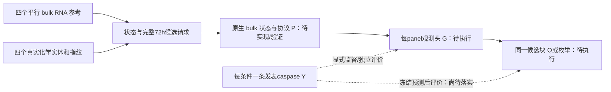

# 第十六轮：真实 RNA—功能参考桥、输入范围与旧权重证据

日期：2026-10-11。接续[第十五轮](DATA_ALIGNMENT_ROUND15_2026-10-11.md)。本轮专项实现和独立复审按用户要求使用 GPT-6.1-sol；主代理负责原文阅读、实际接口、证据综合和最终验收。研究目标仍以[毕业论文研究架构](G:/研究生科研文件/毕业论文/研究架构.md)为准：细胞状态条件化的肺腺癌凋亡响应预测与干预筛选，先以 A549 验证。正式训练保持停止，未运行真实模型 forward 或推理。

## 1. 目前可以怎样回答“缺少对应数据会不会导致模型做不成”

**本轮补到了真实、可读取的同来源跨肺腺癌背景 RNA 参考与功能候选表，并建立保留配对假设的读取路径；完整课题的数据可行性仍未验收通过。** 新来源给出了四个背景、共同单药候选和实测 caspase 图值，可以用于一项有限的背景外推挑战。它不替代 A549 的验证，也没有补成同一细胞或同孔的 RNA—Annexin 配对。

需要修正上一轮的口径：标准连续 24h 的参考 P 描述符，加上读取实际协议的 G，是已经实现的有限对照。**原架构的 P 还必须读取目标状态和完整真实处理协议；目前不能把这项能力算作完成，也不能把剩余问题只归结为缺权重。** 依据是[本轮独立全架构审查](../experiments/20261011-data-alignment-round16/full_contract_review.md)，对应架构 §4.1–4.4、§6。上一轮 G/Q 程序和测试的实施事实保持有效，结论范围按本轮收紧。

本轮的实质进展有四项：取得完整小型 processed RNA；提取并复审同来源真实功能柱均值；把多背景测量域与单次决策块分开登记；通过真实表达和实际 checkpoint 内部 metadata，核实旧资产的可复用范围。接口可读、数值可对照和生物有效性分别验收。

## 2. 新来源是什么，为什么有用

Martin et al. 2022，*Pharmaceutical Reactivation of Attenuated Apoptotic Pathways Leads to Elimination of Osimertinib Drug-Tolerant Cells*，Cancer Research Communications 2(10):1312–1325，DOI [10.1158/2767-9764.CRC-22-0066](https://doi.org/10.1158/2767-9764.CRC-22-0066)。主代理亲读[保存的原文 XML](../experiments/20261011-data-alignment-round16/state_function_new_sources/PMC10035388.xml) Methods sec2-4、sec2-5、sec2-9及 Fig2/3 图注，亲看补图 S2F/M/N。

RNA 子 series 为 [GSE193258](https://www.ncbi.nlm.nih.gov/geo/query/acc.cgi?acc=GSE193258)，超 series 为 GSE193259。这个 GEO 曾以 Criscione 2022 的表达/生长辅助来源出现在架构 §5.1；本轮的新信息是伴随论文中对应背景的 caspase 功能读出。**不能把同一 GSE 重复计算为一个全新表达数据集。**

新增检索使用网页及官方数据定位、Europe PMC 两个互补入口，实际展开四篇全文，按 DOI/PMCID/GSE 去重。FAK/YAP 的关键附件尚未取得，Chavez 的完整共同剂量不明，FGFR 临床初始 RNA 不公开；没有把失败请求或空结果当作“不存在数据”。[检索记录与淘汰依据](../experiments/20261011-data-alignment-round16/state_function_new_sources.md)保留范围、返回、失败回退与 Zotero 全库 60 条精确只读核对。本轮没有写回 Zotero，也没有联系作者。

## 3. RNA 已经实际读到什么

两个官方文件均已完整下载到[新数据目录](../08-datasets/LungCancer_A549_Integration/state_function_martin2022_v1/README_RNA.md)，保留官方原名。

| 资产 | 实际读取结果 |
|---|---|
| estimated_counts 压缩文件 | 8,413,632 bytes；19,712 行 × 60 列；非负、有限，允许估计小数 |
| log2TPM 压缩文件 | 8,364,455 bytes；相同轴和顺序；有限，允许负值 |
| 四个 RNA 背景 | HCC2935、HCC827、H1975、PC9；H1975 与功能的 NCI-H1975 在桥侧显式对应，原名保留 |
| 每背景五组 | parental DMSO、acute、DTP、short washout、long washout；每组 3 个生物 RNA 重复 |
| 可作为平行亲本参考的 RNA | 12 列，四个背景各 3 列；不是 12 个独立功能状态或单细胞 |
| 独立源值核查 | 两矩阵合计 2,365,440 个数值，与官方 gzip 中逐行解析的浮点数精确一致 |
| 当前共同基因轴 | 16,167 / 32,461 有双方唯一的精确 symbol 对应，49.8044%；16,294 缺失保持 mask |

源矩阵是 **gene symbol 轴**，没有提供 Ensembl ID/version 后缀。GEO 声明的 hg38/Ensembl v79 是原处理注释，不代表本轮完成跨版本重定量。只使用双方唯一的精确同名符号，未扩展别名，也未生成将缺失补成零值的共同轴表达。

GEO data_processing 将 counts 定义为 tximport 的 `countsFromAbundance=lengthScaledTPM`，log2TPM 为 `log2(TPM+0.01)`。[60 个 GSM 原字段](../08-datasets/LungCancer_A549_Integration/state_function_martin2022_v1/rna/geo_samples_source.json)与[RNA manifest](../08-datasets/LungCancer_A549_Integration/state_function_martin2022_v1/rna_manifest.json)记录出处、源文件 hash、时钟及完整检查。它们是 bulk 表达，不能当作单细胞整数 UMI 或直接输入旧单细胞状态分类器。

RNA 协议为 500nM osimertinib 21d DTP、撤药后短 24h 或各背景规定的长恢复；亲本平行培养 21d 后作 vehicle 或 500nM/24h acute。**acute 是药后表达，不能作为该次挑战的给药前输入。** 这些 RNA 并未匹配下面 160nM/72h 的功能后表达。详细时钟与每列 GSM 身份见[RNA 回执](../experiments/20261011-data-alignment-round16/martin_rna_receipt.md)。

## 4. 功能数据具体是什么

补图 [S2F 原图](../experiments/20261011-data-alignment-round16/state_function_new_sources/Martin2022_image3.jpg)、[S2M/N 原图](../experiments/20261011-data-alignment-round16/state_function_new_sources/Martin2022_image4.jpg)及[补充图注](../experiments/20261011-data-alignment-round16/state_function_new_sources/Martin2022_supplement.md)提供有限共同候选。六个功能背景中四个有上述 RNA，另外两个没有被补成 RNA 背景。

| Panel | 四个有 RNA 背景内的共同候选 | 发表图值数量 |
|---|---|---:|
| S2F | vehicle；osimertinib 160nM；venetoclax 300nM；AZD4320 300nM；原图规定的两种 osimertinib 组合 | 24 |
| S2M | vehicle；osimertinib 160nM；K-975 100nM；原图规定的 osimertinib/K-975 组合 | 16 |

这 40 个身份是**发表柱均值**：20 个活性单药、8 个 vehicle、12 个组合。主要接入保留 20 个单药，vehicle 和组合留在原功能表作为辅助；没有拆分组合生成伪单药，也没有挑选效果较好的药物作为核心。S2F、S2M 同药柱保留各自 panel 身份，不假称独立生物批次。

Methods sec2-5 的读出为 caspase-3/7 green spots 除以 confluence，再按 DMSO 的 72h 值归一；补图注明 72h 信号 AUC。积分算法、完整 AUC 单位和是否还有 AUC 层归一化未充分说明。因此输出保持原图相对 caspase 尺度，不转成 Annexin 阳性 fraction、绝对凋亡率或终点细胞命运。三孔重复也不能写成三次独立生物实验。**取得原始独立生物功能重复的数量为 0；不是说作者没有做实验。**

两图纵轴均为 log10。已保存轴刻度、柱顶原生像素、校准公式和图源 hash；读图界为柱顶 ±2px 加轴定位 ±1px，经对数公式换成数值范围。这不是 SD 或 CI，也不包括全部生物、积分与归一化误差。CSV 的长小数只是计算输出，不能据此声称生物学精度。

初版一根 S2M NCI-H1975 osimertinib 柱偏了 4px，独立复审发现后撤回旧数值，复核全部 20 根单药柱并纠正五处定位。初版副本留在[复审前目录](../experiments/20261011-data-alignment-round16/martin_function_before_review/sha256.json)，修正后的 [published_means.csv](../08-datasets/LungCancer_A549_Integration/state_function_martin2022_v1/function/published_means.csv) SHA 为 `b685c96f28e5abe51bb13ee5621fb4eeea8720cc694bf474b8591b79999f7a61`，独立复验已通过。[数字化回执](../experiments/20261011-data-alignment-round16/martin_function_receipt.md)记录具体纠正，未修改原图。

S2N 的 DTP 再挑战保留隔离：功能通用诱导为依实验 10–21d，RNA 为 21d，S2N 未单独明确实际诱导日数，不能直接配成相同初态。当前未提取它的功能标签。

## 5. 新读取器怎么衔接，怎样避免错误配对

[MartinStateFunctionInputs](../src/lung/data/martin_state_function.py)已经真实读取 [bridge_v2](../08-datasets/LungCancer_A549_Integration/state_function_martin2022_v1/bridge_v2/manifest.json)。它保留三种对象：

1. **RNA 参考对象**：每个背景一个 reference_id，指向三个原 bulk RNA 列及 GSM。三个 RNA 重复共同描述参考，不为每列复制功能 Y。来源明确是平行参考，功能同孔、同批次及实际初态等价均未验证。
2. **完整单药候选对象**：源药物名称、官方化学实体、真实指纹、标称浓度、72h 处理和观察窗、背景与 reference_id。撤药未描述、隔夜贴壁无具体小时数、实验 stock form 未认证，均保留其信息状态。没有复用标准 Tahoe 24h 请求冒充真实 72h 响应。
3. **功能观测对象**：每发表单药均值一条，权重 1；独立 `observations.json` 保存相对 caspase 数值与读图界。输入和 metadata 路径只做该文件的字节 hash，不解析 Y。标签通过显式 observation API 读取。

图中的 P/G/Q 是后续职责，**不能把箭头存在当作真实模型已经运行**。当前已接入的是参考、候选、功能身份与信息隔离路径。旧 fraction G 会把输出截到 [0,1]，与这个相对 caspase 域不兼容；旧 adapter 的 A549 状态词表和共同 24h P 也不直接兼容此源。

四个单药的名义 parent 结构已经核验：osimertinib CID71496458、venetoclax CID49846579、AZD4320 CID86661883、K-975 CID155353714。保留官方响应与准确名称/同义词；真实 4×2048 Morgan 指纹沿用 radius2、chirality=true。20 个候选逐行绑定正确实体，160/300/100nM 对应 0.16/0.3/0.1µM。实验 stock 的盐形式和剂量活性成分口径仍未知，不把官方 parent 身份当作实验批次认证。[化学说明与回执](../experiments/20261011-data-alignment-round16/martin_chemistry_receipt.md)。

初版 bridge_v1 建立早于化学 manifest 最终更新，hash 守卫正确拒绝读取。已保留原字节，并另建 v2；没有绕过守卫。当前 v2 同时绑定来源、RNA、功能、化学和五个关键源码文件。

## 6. 多背景训练域与单次排行范围已经分开

原 Round15 的 G 要求所有 fit 样本的完整 source/state/scenario scope 相同，这限制了多状态比较。本轮新数据契约明确区分：

| 契约 | 允许范围 | 保留的限制 |
|---|---|---|
| measurement/training domain | 同 panel/检测定义和相对尺度，可包含多个参考背景 | S2F/M 分头，不跨图混绝对分数，不接旧 Annexin fraction 头 |
| decision block | 同背景 reference、同 panel、同 72h 观察窗的全部规定单药 | 不混背景、panel，不按 Y 任意缩小候选；一次只排行本块 |
| holdout fold | 每次完整留出一个背景；其余三个背景为 fit | 是背景外推，不是 A549 内状态增量；RNA与背景共变须设置背景类别对照 |

已冻结四个回顾性 LOBO fold。每 fold 共 15 个 fit、5 个 final 条件；分到 S2F 为 9/3，S2M 为 6/2。两 panel 各自只有三个或两个单药候选，不能拼成一个跨 panel 最优药物排行。四 fold 重复使用同一批 20 条 Y，不增加独立实验数。

角色由背景名称和固定 panel 元数据确定，不按 Y 的高低选择。本计划没有 selection 角色，不能用 final Y 调超参数、放宽奖励资格或决定分数方向。目前正式预测冻结只写在标签接口的契约中，尚未实现对应模型评价入口；**这个新源没有获得 Q 奖励资格**。后续须固定模型/候选/观测域、保存完整候选预测后再评价真实 Y。

新契约没有直接修改旧 G/Q learner 或其冻结角色包，也没有宣称多状态 G 已训练。完整方法仍需将同一个状态/协议条件机制、来源观测头和候选价值规则真正接通，并在至少一个实测功能块运行完整程序及对照。

## 7. 旧训练结果有没有完全浪费

本轮取得了比“旁边有一个 JSON”更直接的证据：通过 [metadata 静态检查器](../scripts/inspect_checkpoint_metadata.py)，仅读取四个指定 checkpoint ZIP 的 `data.pkl`，使用非执行的 opcode 解析，未执行 pickle 构造器，未读 tensor storage。

| 实际文件内容 | epoch | optimizer_step | 身份范围 |
|---|---:|---:|---|
| AE continuation/last.pt | 83 | 3431 | 旧完整数据 identity `0560…67b4` |
| response/member_1/last.pt | 0 | 7 | 同上；不能以相邻 JSON 的 step10 代替当前 pt 内容 |
| bounded real pool/last.pt | 1 | 1 | 有界视图 identity `d6cb…02e4` |
| bounded real state/calibrated.pt | 1 | 4 | 同有界视图 |

AE 未序列化 `synthetic` 字段，不能仅凭缺失推断 false；另外三个明确为 false。四个 payload 共 114,779 bytes。[主代理重新读回](../experiments/20261011-data-alignment-round16/checkpoint_metadata_inspection/results-main-v2.json)与原字段/hash 全部一致。这证明旧进度有实际序列化记录；不证明张量有限、恢复成功、预测质量或联合数据资格。

[旧 P 兼容性核查](../experiments/20261011-data-alignment-round16/legacy_P_compatibility_map.md)确认，14 个标准 P 请求本身不必都依赖 joint 的双来源/双协议输入，但旧 reference anchor 的 role、context 编码和各 stage 绑定仍有差异。2431 个参考 control IDs 与旧 fit control 集合重合，不允许据此把旧 treated anchor 从 residual_fit 改成 fit，或把 response 文件当作潜空间 CFM。

因此旧成果可以作为有证据的待复用资产；目前完整 AE/response/pool/state 组合和新生产路线尚未取得使用资格。未恢复训练或真实模型推理。

## 8. 共同基因轴下的标准化坐标转换已真实验证

主代理亲读实际[log_normalize/standardized](../src/lung/data/preprocess.py:23)与桥源码。对**同一 Tahoe 原始计数、同一有序共同基因轴、同一 library normalization/log1p**，本课题直接消去共同基底表达 x 得到：

$$z_{old}=z_{new}\frac{s_{new}}{s_{old}}+\frac{\mu_{new}-\mu_{old}}{s_{old}}.$$

这是按当前标准化定义推导的逐基因代数恒等式，不是模型迁移定理。[严格桥实现](../src/lung/data/normalization_bridge.py)要求有限实数 mean、正有限 scale、实际 hash、相同 gene IDs/基础转换/单位；不同轴、单位、clipping 或复数输入拒绝。

实际从冻结的 2431-cell control pool 按 ID 取八个真实 cells × 32,461 genes，读取原始计数行，比较 direct old 与 new→old。最大绝对误差为 **1.9073486328125×10⁻⁶**；反向相同，双向有限并通过所声明 float32 容差，**不是逐 bit 相同或全数据误差上界**。保存数组重新打开及新代码复算与其各自输出全等。[真实验证](../experiments/20261011-data-alignment-round16/normalization_bridge/receipt.md)、[修复后代码增量](../experiments/20261011-data-alignment-round16/normalization_bridge/code_revision_validation.json)保留不同版本。

这项桥不适用于直接把新 bulk TPM 变成 Tahoe 原始计数坐标。它没有接入 World/producer，未转换 graph、bandwidth、context、协议 embedding、优化器或 data identity。协议旧 ID0、joint ID1 必须按语义登记，不照搬数字。

## 9. 关键缺口按原课题能力划分

下表 A–D 是研究能力，区别于模型图中状态头 C 的名称。

| 研究能力 | 数据与本轮推进 | 未通过部分 |
|---|---|---|
| A：表达状态信息是否改善响应 | 既有真实参考/处理设计继续有效；新增真实 bulk 参考和严格坐标工具 | 未运行完整参考分布对均值/简单响应基线；新 bulk 不构成 A549 内单细胞增量证据 |
| B：未见条件泛化 | 留出真实条件计划继续有效；新增四背景 LOBO 元数据角色 | native P 对这些背景/72h协议的范围、P/G各自见过的训练数据和真实外推效果未验 |
| C：凋亡相关真实功能预测 | A549 Annexin 块保留；新增同来源相对 caspase 块及保守参考桥 | 两种检测不混尺度；平行背景桥未验证；绝对 Annexin 校准及细粒度 RNA 功能增量未验 |
| D：完整候选选择 | 新增八个可读完整单药块；Viel A549 实际暴露块保留 | 尚无同一冻结 P→G→Q/枚举链的实测选择评价；Q没有自动优于枚举的保证 |

新源不是所有缺口的答案。它使一个实际的功能挑战能够明确到 RNA 列、药物结构、协议和观测身份；主线的科学收益仍需接受独立实测的反驳。若数据不能支持某项更强主张，应调整主张范围，不能借立项事实或内部奖励保证结论。

## 10. 实际验证、复审与本轮文件

主代理运行六组本轮新增检查：**70 passed in 2.05s**，覆盖真实 RNA 读取、化学结构/行绑定、原生像素边界、label-free serving、训练域与决策块、坐标转换和静态 checkpoint 安全边界。[测试日志](../experiments/20261011-data-alignment-round16/pytest-main.txt)。涉及固定小型 tensor fixture 的测试只保存样本，未加载模型或执行预测。

[主代理 verifier](../experiments/20261011-data-alignment-round16/verify_round16.py)实际通过：v2 新源 hash/参考/候选读取、保存八行转换复算、四个实际 payload 字段、四项冻结旧入口及研究架构 hash。[validation.json](../experiments/20261011-data-alignment-round16/validation.json)明确 `actual_model_execution=false`、`formal_training_resumed=false`。

独立复审留下修复前反例与关闭记录：

- [完整架构审查](../experiments/20261011-data-alignment-round16/full_contract_review.md)：保留原主线，识别标准 P、单状态 G 和多域测量的实质范围缺口。
- [新来源与读取器审查](../experiments/20261011-data-alignment-round16/martin_independent_review/technical_review.md)：源值/像素/alias/化学/LOBO/v2 读回通过；原生 P 和正式冻结评价保持 pending。
- [checkpoint 检查器审查](../experiments/20261011-data-alignment-round16/checkpoint_independent_review/independent_review.md)：MARK 操作数与不支持 ZIP 错误处理两项 P2 已关闭，27 个独立 probe 及四真实 metadata 通过。
- [坐标桥审查](../experiments/20261011-data-alignment-round16/normalization_bridge_independent_review.md)：复数输入丢失虚部的 P2 已拒绝并关闭，真实八行结果保持不变。

本轮只增加相关脚本、测试、数据小包与文档；旧冻结输入/监督、joint manifest 和毕业论文架构字节未改变。Git 保持此前已有脏工作树，未提交或推送。没有新 Cloud/Dot 派单，本轮复审来自这里实际派发的 6.1sol 专项代理，不能说 Cloud/Dot 已再次审过新数据。PerturbCellRL v2 的此前原件审查沿用[总状态第13节](DATA_ALIGNMENT_STATUS_2026-10-10.md#13-perturbcellrl-v2对当前数据问题的帮助和限制)，没有把它的未配对分布学习能力扩大成凋亡标签保证。

## 11. 接下来继续推进的具体问题

第一，按完整架构审查定义目标状态和实际协议的原生 P 输入与表示，保留标准 24h 参考路线作为对照；协议字段存在不等于模型实际利用它。第二，将多状态训练域与单次决策块真正接到 G/Q learner 和独立 assay 头，落实冻结预测/评价入口；本轮只完成对应数据契约。第三，分别登记 A549 与跨 LUAD 的表达训练范围、功能参考桥、背景类别/均值/药物对照和缺失 mask，控制以背景 ID 代替 RNA 的混杂。第四，之后获得相应执行授权时再使用合格真实模型运行完整功能链，分别判断负结果、范围不足和数据缺口，不恢复已经停止的训练。

**当前目标继续 active：新数据和输入证据已有实质补充，完整数据可行性、真实模型执行和科学效果仍分开待验。**
